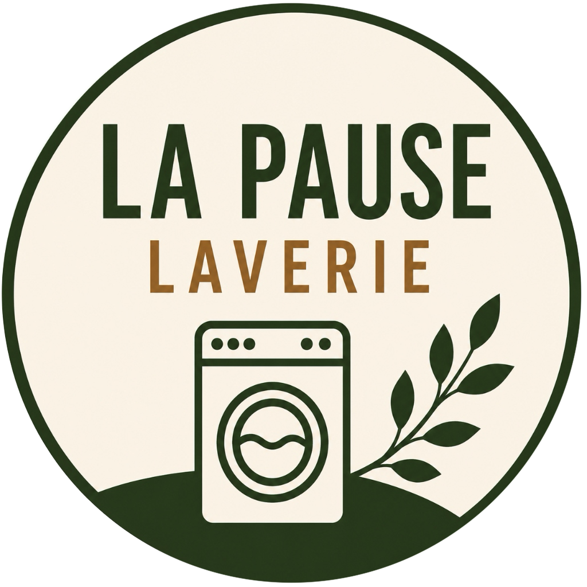

<p align="center">
  
</p>

<h1 align="center">La Pause Laverie</h1>

<p align="center">
  Le site d'une vraie laverie de quartier à Compiègne, conçu, livré et maintenu en production.<br/>
  <a href="https://lapauselaverie.fr"><strong>→ Voir le site en ligne : lapauselaverie.fr</strong></a>
</p>

<p align="center">
  
  
  
  
  
</p>

---

## En bref

**La Pause Laverie** est une laverie automatique indépendante à Compiègne, qui propose aussi un service de blanchisserie avec ramassage et livraison. Elle est tenue par une personne de ma famille, qui avait besoin d'une présence en ligne simple : qu'un habitant du quartier trouve en quelques secondes les horaires, les tarifs, l'adresse, et puisse la contacter sans friction.

C'est un projet fait en famille, sans contrat ni facture, mais traité comme un vrai produit. Ce dépôt contient le code du site, en production depuis 2026. Je l'ai pris en charge de bout en bout : cadrage du besoin, choix des fonctionnalités, conception, mise en ligne, puis évolutions au fil de ses demandes.

> **Pourquoi ce projet est sur mon GitHub** : je suis Product Manager, pas développeur. Ce site montre comment je mène un produit du besoin réel jusqu'à la mise en production, en m'appuyant sur des outils d'IA (Claude Code) pour l'implémentation, pour un vrai commerce, avec de vrais utilisateurs et un vrai suivi.

## Ce que le site permet de faire

| Besoin du visiteur | Réponse dans le site |
|---|---|
| « C'est ouvert quand ? C'est où ? » | Horaires (7j/7, 6h–22h), adresse et carte intégrée, dès la première page |
| « Combien ça coûte ? » | Grille tarifaire claire : laverie (10, 15, 20 kg, séchage) et blanchisserie (couettes, draps, serviettes) |
| « Je n'ai pas le temps de venir » | Service blanchisserie avec **ramassage et livraison dans un rayon de 10 km**, réservable en un clic via WhatsApp |
| « J'ai besoin d'un accès adapté » | Section accessibilité PMR : rampe amovible sur demande et jours de permanence d'accueil |
| « Je reviens souvent » | Carte de fidélité présentée en ligne (10 tampons = 1 lavage offert) |
| « À quoi ça ressemble ? » | Galerie photo de la laverie et fil Instagram |

## Choix produit

- **WhatsApp plutôt qu'un formulaire de contact.** Les clients d'une laverie de quartier écrivent plus volontiers sur WhatsApp que par mail. Chaque bouton ouvre une conversation avec un message déjà rédigé selon le contexte (renseignement, réservation de ramassage, accès PMR), pour que la gérante sache tout de suite de quoi il s'agit.
- **Une seule page, pensée mobile d'abord.** On cherche une laverie depuis son téléphone, souvent sur le pas de la porte. Tout ce qui compte tient sur une page qu'on fait défiler.
- **Une source unique pour les infos de la laverie.** Tarifs, horaires, adresse et contacts sont rassemblés dans un seul fichier (`src/lib/constants.ts`). Une hausse de prix ou un changement d'horaire se met à jour à un seul endroit.
- **Visible localement.** Données structurées schema.org (`Laundromat`), métadonnées et aperçus de partage soignés pour bien apparaître dans les recherches « laverie Compiègne » et quand le lien est partagé.
- **Une identité visuelle propre à la marque.** Vert et beige, logo dédié, et une touche ludique : des bulles de savon animées en fond, placées pour ne jamais gêner la lecture.
- **Mesurer avant de décider.** Vercel Web Analytics suit la fréquentation sans cookies intrusifs, pour orienter les prochaines évolutions.

## Comment je fais vivre le produit

1. La gérante m'envoie ses idées et ses demandes par mail (nouveau tarif, horaire, photo, nouvelle section…).
2. Je les reformule en besoin, je priorise et je décide de la solution.
3. L'implémentation est faite avec Claude Code, sur une branche séparée.
4. Je relis et je valide avant toute mise en ligne.
5. La fusion dans `main` déclenche le déploiement automatique sur Vercel : la modification est en ligne en quelques minutes.

L'historique des commits retrace ces évolutions, de la première version aux derniers ajustements.

## Stack technique

- **Framework** : [Next.js 16](https://nextjs.org) (App Router) avec React 19
- **Style** : Tailwind CSS 4
- **Langage** : TypeScript
- **Icônes** : lucide-react
- **Hébergement** : Vercel, déploiement continu depuis la branche `main`
- **Mesure d'audience** : Vercel Web Analytics

## Structure du code

```
src/
├── app/
│   ├── layout.tsx            # Métadonnées, SEO, données structurées, analytics
│   ├── page.tsx              # Page d'accueil (assemble les sections)
│   └── mentions-legales/     # Page mentions légales
├── components/               # Une section du site = un composant
│   ├── Hero.tsx              # Accroche principale
│   ├── Tarifs.tsx            # Grille tarifaire
│   ├── Blanchisserie.tsx     # Service blanchisserie + ramassage
│   ├── CarteFidelite.tsx     # Carte de fidélité
│   ├── GalleryCarousel.tsx   # Galerie photo
│   ├── Infos.tsx / Map.tsx   # Horaires, adresse, carte
│   ├── PermanencePMR.tsx     # Accessibilité
│   ├── InstagramFeed.tsx     # Fil Instagram
│   └── Bulles.tsx            # Bulles de savon décoratives
└── lib/
    └── constants.ts          # Infos de la laverie : tarifs, horaires, contacts
```

## Lancer le projet en local

Prérequis : [Node.js](https://nodejs.org) 20 ou plus.

```bash
git clone https://github.com/anthonyverbois-ai/vermax.git
cd vermax
npm install
npm run dev
```

Puis ouvrir [http://localhost:3000](http://localhost:3000).

## Auteur

**Anthony Verbois**, Lead Product Manager.
Plus de 10 ans de product management en B2B SaaS. Ce projet fait partie de mes réalisations personnelles.

[GitHub](https://github.com/anthonyverbois-ai)
